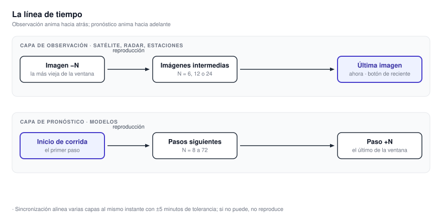
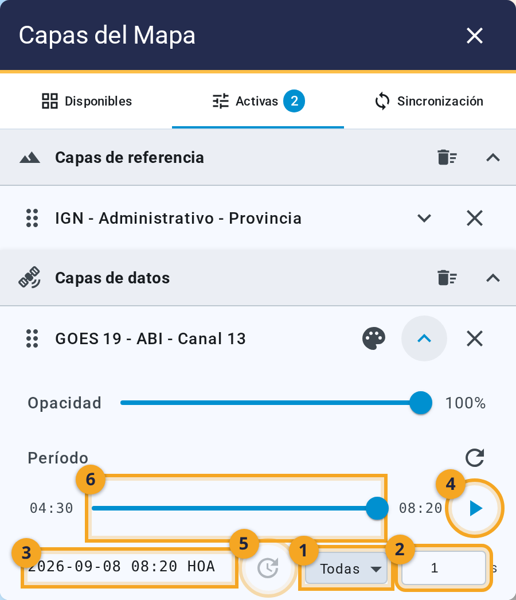
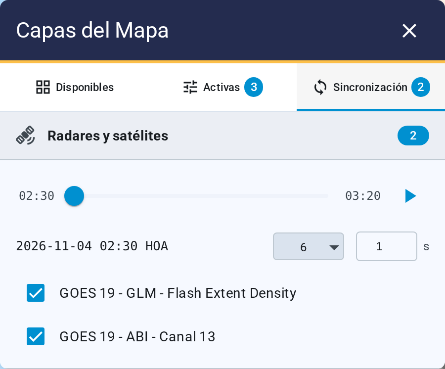
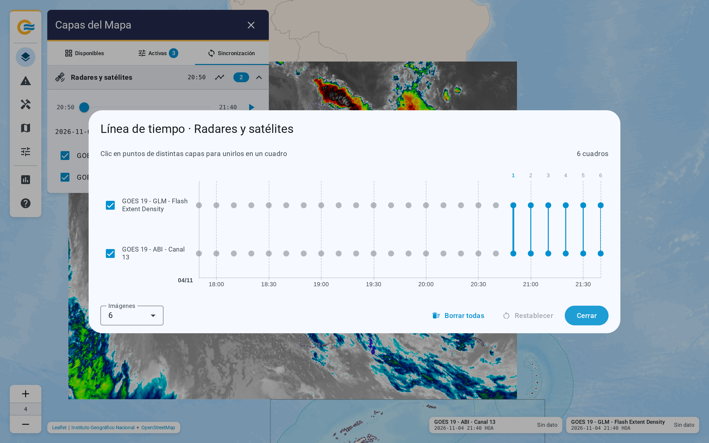
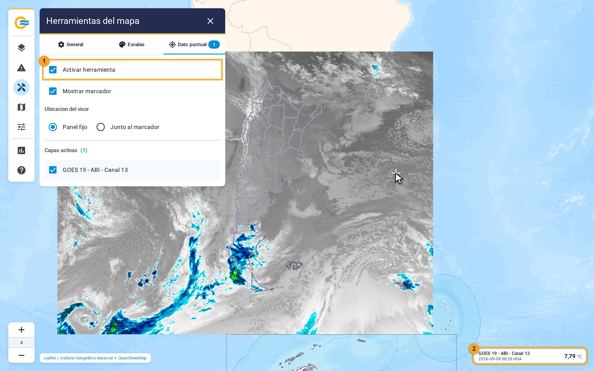

# 5. Ver la evolución y consultar un punto

Las capas temporales incluyen una sección Período desde la cual se elige una imagen o se reproduce la
secuencia completa. El mismo capítulo explica la consulta puntual, que recupera el valor numérico de
una capa en una coordenada del mapa.

{ .diagram loading=lazy }

Observación y pronóstico animan hacia lados distintos. Una capa de satélite, radar o estaciones
recorre las últimas imágenes y termina en la más reciente. Una capa de modelo recorre los primeros
pasos de la corrida, empezando por la hora de inicio. El mismo control se comporta distinto según
la capa.

## Animar una capa

{ .doc-figure loading=lazy }

Los números de la lista son los de la captura.

1. El selector de cantidad de imágenes. Las opciones dependen de la familia: 6, 12 o 24 en
   satélite; 6 o 12 en radar; hasta 72 en WRF.
2. El intervalo, en segundos por imagen, entre 0,1 y 10.
3. La marca de tiempo de la imagen que estás viendo, con su sufijo HOA o UTC.
4. El botón de reproducción.
5. Las horas de los extremos del deslizador. Un clic en la de la izquierda lleva a la primera
   imagen y en la de la derecha a la última; al pasar el mouse se subrayan.
6. El deslizador para moverte cuadro por cuadro. Sigue funcionando con la reproducción
   detenida.

<video preload="none" loop muted playsinline title="Reproducir la animación de una capa"
       width="100%" poster="../../videos/05-animacion-poster.webp"
       style="max-height: 500px">
  <source src="../../videos/05-animacion.webm" type="video/webm" />
  Tu navegador no soporta este video.
</video>

La lista de imágenes se renueva sola cada diez segundos. El botón de recarga junto al título
Período fuerza esa consulta. Si la capa no tiene nada que mostrar, el lugar del deslizador lo dice:
"No hay períodos disponibles", o qué falta elegir antes, como una elevación o una corrida.

## Animar varias capas juntas

Si reproducís dos capas por separado, cada una avanza a su ritmo. La pestaña Sincronización las
anima juntas, mostrando en cada cuadro el mismo instante en todas.

No hace falta elegir las capas. La pestaña las reparte en grupos de capas con horarios parecidos, y
cada grupo tiene su propia barra, cantidad de imágenes, velocidad y botón de reproducción, así que
podés animar los dos a la vez:

- **Radares y satélites**: las capas de radar y GOES-19. Una imagen acompaña al instante si está a
  menos de cinco minutos.
- **Modelos numéricos**: WRF, GFS y ECMWF. Una imagen acompaña al instante si está a menos de
  media hora.

Las estaciones meteorológicas no participan: se animan desde su propia capa.

{ .doc-figure loading=lazy }

Toda capa que encendés entra sola en su grupo y aparece marcada. Cuando el grupo ya tiene otra capa
compatible, el grupo queda listo para reproducirlas; si no, la pestaña indica qué encender. Con una
sola capa, la capa conserva sus controles propios. Si desmarcás una capa, sale del grupo hasta que
la apagues y la vuelvas a encender, o la vuelvas a marcar.

Los instantes los marca la capa del grupo con imágenes más espaciadas: cada una de sus últimas
imágenes es un cuadro, y cada otra capa suma su imagen más cercana. Si a alguna capa le falta la
imagen de un instante, o la tiene demasiado corrida, en ese cuadro sigue mostrando la que tenía. Una
capa que coincide en menos de dos instantes queda afuera, con la nota "sin horarios en común".

### Ver y editar la línea de tiempo

El botón de línea de tiempo del encabezado de cada grupo abre un gráfico con un carril por capa.
Cada punto es una imagen, y cada línea es un cuadro de la animación que une las imágenes que se
ven juntas; los puntos resaltados son los que entran en algún cuadro. Arriba de cada línea está el
número del cuadro, y el que se está mostrando queda resaltado mientras la animación corre. Un tramo
punteado cruza una capa que ese cuadro no incluye.

{ .doc-figure loading=lazy }

Por defecto la aplicación arma la combinación más pareja, y desde ahí podés armar los cuadros a
mano. Cada cuadro tiene una imagen de cada capa como mucho y una como mínimo; la capa que un cuadro
no incluye sigue mostrando la imagen que tenía. La hora de un cuadro es el promedio de las horas de
sus imágenes, y es la que ordena los cuadros y la que muestra el reproductor.

Cada carril tiene a su izquierda la casilla de su capa: destildarla la saca del grupo y tildarla la
vuelve a sumar, igual que en la pestaña. Las capas que quedan afuera (por no tener horarios en común
o porque las destildaste) siguen en su carril, en gris y con el motivo; sus puntos se ven pero no se
pueden unir.

- **Armar un cuadro**: un clic en un punto suelto empieza un cuadro, y cada clic en un punto de
  otra capa lo suma, en el orden que quieras y salteando las capas que quieras. Un punto de una capa
  que ya está en el cuadro reemplaza su imagen; un clic en un punto del cuadro lo quita. Con una
  imagen de cada capa el cuadro se termina solo; si no, **Listo** (o Enter) lo termina, aunque tenga
  una sola imagen, y **Cancelar** (o Esc) lo descarta y deja los cuadros como estaban. Un doble clic
  en un punto, o un clic en el fondo del gráfico, también lo termina.
- **Sin cruces**: ninguna capa puede volver atrás de un cuadro al siguiente, así que las líneas no
  se cruzan. Si un cuadro cruzaría a otro, su línea se pinta en rojo, la barra indica en qué capa
  y no se puede terminar hasta corregirlo.
- **Editar un cuadro**: un clic en su línea, o en uno de sus puntos, lo vuelve a abrir para sumar o
  quitar imágenes. **Listo** guarda los cambios y **Cancelar** los deshace.
- **Borrar un cuadro**: mientras lo editás, **Borrar conexión** o la tecla Supr. **Borrar todas**
  vacía la línea de tiempo para empezar de cero.
- **Restablecer** vuelve a la combinación automática.

La cantidad de imágenes se elige en la pestaña o abajo a la izquierda de la línea de tiempo; elegir
otra vuelve a la combinación automática.

Mientras un grupo se reproduce, cada una de sus capas:

- Muestra en su sección Período la marca "Sincronizado".
- Tiene sus controles propios deshabilitados: manda la sincronización.
- Ofrece en su botón de reproducción "Desconectar de sincronización".

En pausa, cada capa recupera sus controles. El número junto a la pestaña Sincronización cuenta las
capas de los grupos que se están reproduciendo. Cada grupo se puede plegar; su encabezado sigue
mostrando si se reproduce, el instante actual y cuántas capas tiene.

Si desconectás una capa desde su propio botón de reproducción, o le cambiás la cantidad de imágenes,
sale del grupo y conserva la cantidad de imágenes que tenía sincronizada.

## Consultar un valor puntual

Los colores dan una idea aproximada. La consulta puntual devuelve el número. Está en
Herramientas del mapa > Dato puntual.

{ .doc-figure loading=lazy }

1. La herramienta viene activada de fábrica. Si la apagaste, marcá Activar herramienta (1).
2. Marcá, bajo Capas activas, qué capas querés consultar. Cada capa de datos que encendés se
   agrega sola a la lista. Una capa sin marcar no devuelve nada.
3. Hacé clic en el mapa.

<video preload="none" loop muted playsinline title="Consultar el valor de una capa en un punto"
       width="100%" poster="../../videos/05-consulta-poster.webp"
       style="max-height: 500px">
  <source src="../../videos/05-consulta.webm" type="video/webm" />
  Tu navegador no soporta este video.
</video>

Cada capa consultada tiene un panel (2) con su nombre, su instante, su corrida o elevación si
corresponde, y el valor con su unidad. El valor es el dato, no el color leído de la imagen. El
panel dice "Sin dato" hasta el primer clic, y donde la capa no tiene dato. Cada panel se cierra
con su propia cruz.

El valor sigue a la capa: al mover su período o al reproducirla, el panel consulta el instante
nuevo para el mismo punto. Mientras llega, el valor anterior queda atenuado. Los instantes ya
consultados se recuerdan, así que al repetir la animación los valores aparecen sin espera.
Mientras la capa se reproduce, un punto que late junto a su nombre lo indica.

La casilla Mostrar marcador deja una marca en el punto consultado. Con el marcador prendido
aparece Ubicación del visor: Panel fijo junta los resultados en la columna derecha, y
Junto al marcador los pega al punto. La consulta y sus resultados se recuerdan al volver a
entrar.
