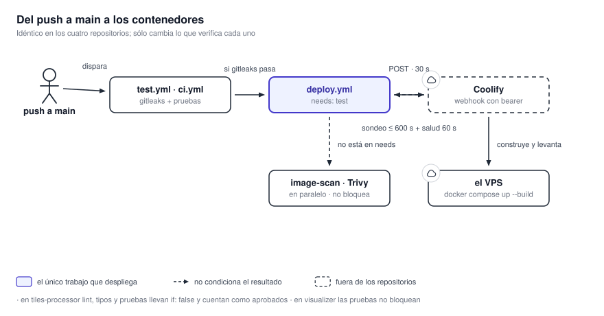

# 17. Despliegue y entrega continua

El sistema admite dos formas de entrega. Los componentes pueden desplegarse por separado mediante
los workflows que llaman a Coolify, o pueden publicarse como una versión conjunta de
[`mapasmn`](beta-1.md). En este último caso, el commit del repositorio de integración fija las cuatro
revisiones que forman Beta-1. Ninguno de los dos mecanismos incluye el proxy inverso ni la
configuración TLS de la instalación.

{ .diagram loading=lazy }

## Publicar una versión Beta-1

Beta-1 separa la publicación del código de la publicación de la integración:

1. El cambio se prueba y se publica en el repositorio del componente.
2. `mapasmn` actualiza el puntero de ese submódulo al commit elegido.
3. Se revisa el modelo resultante de `compose.beta-1.yaml` y la configuración congelada del
   procesador.
4. Se publica el commit de `mapasmn`. Ese commit es la versión desplegable.
5. En la VM se ejecutan `git pull --ff-only`, `git submodule update --init --recursive` y
   `make beta1`.

Actualizar un componente directamente dentro de la VM rompe esa reproducibilidad. `make update`
también avanza los cuatro submódulos a sus puntas remotas; es una herramienta de mantenimiento para
preparar el paso 2, no el comando de despliegue.

El retroceso parte del commit anterior de `mapasmn`: al volver a él y sincronizar los submódulos se
restauran juntas las revisiones anteriores. Los volúmenes persisten, por lo que cualquier migración de
datos requiere su propio procedimiento de compatibilidad.

## Despliegues independientes por Coolify

### Los nueve workflows

| Repositorio | Workflow | Disparador | Qué hace |
|---|---|---|---|
| `tiles-processor` | `ci.yml` | Push y pull request fuera de `main`, y llamada desde `deploy.yml` | Lockfile y gitleaks. Lint, tipos y pruebas suprimidos |
| `tiles-processor` | `deploy.yml` | Push a `main` | Llama a `ci.yml` y despliega |
| `tiles-processor` | El de seguridad | Push a `main`, pull request, lunes 06:00 | Trivy sobre la imagen, sólo informe |
| `data-service`, `alerts-service`, `visualizer` | El de pruebas | Push y pull request fuera de `main`, y llamada desde `deploy.yml` | gitleaks y pruebas |
| Los mismos tres | `deploy.yml` | Push a `main` | Pruebas, Trivy en paralelo, y despliegue |

### Qué bloquea de verdad un despliegue

La intención aparente y el efecto real no coinciden.

| Repositorio | Lo único que detiene un despliegue |
|---|---|
| `tiles-processor` | `poetry check --lock` y gitleaks |
| `data-service`, `alerts-service` | gitleaks y las pruebas |
| `visualizer` | gitleaks. Las pruebas llevan `continue-on-error`. |

!!! warning "En `tiles-processor` la compuerta está en verde por construcción"
    Los trabajos `lint`, `type-check` y `unit-tests` llevan `if: false`, marcados como suprimidos
    sin fecha ni issue. La compuerta final corre con `if: always()` y sólo falla ante `failure`
    o `cancelled`. Un trabajo salteado reporta `skipped`, así que pasa. La acción compuesta que
    preparaba el entorno de Python quedó sin uso.

!!! warning "Trivy no bloquea ningún despliegue en ningún repositorio"
    En `data-service`, `alerts-service` y `visualizer`, el escaneo de imagen no figura en las
    dependencias del trabajo de despliegue: corre en paralelo. Un hallazgo crítico pone el
    workflow en rojo después de que la aplicación ya se desplegó. En `tiles-processor` el escaneo
    vive en un workflow aparte que `deploy.yml` no invoca. Además, todas las excepciones de Trivy
    de `alerts-service` vencieron el 1 de septiembre de 2026; las de `data-service`, en julio
    y octubre. Revisar los archivos `.trivyignore.yaml` antes de una entrega.

### La secuencia de despliegue

Idéntica en los cuatro repositorios:

1. `POST` al webhook de Coolify con un token bearer, con tope de 30 s.
2. Validación de la respuesta y extracción del identificador del despliegue.
3. Sondeo de `/deployments/<uuid>` hasta 600 s. El intervalo crece de 2 en 2 hasta 10 s; ante
   errores de la API se duplica y aborta tras tres fallos seguidos.
4. Sondeo de `/applications/<uuid>` durante 60 s, cada 3 s, hasta ver la aplicación sana.
5. Ante fallo, un paso condicional vuelca los registros del despliegue.

!!! note "Tres salidas blandas"
    Si el chequeo de salud agota su tiempo, el trabajo termina en éxito igual. Un despliegue
    marcado como reinicio se saltea los chequeos. Y un estado `running:unknown` también cuenta como
    éxito. Un workflow verde no prueba que la aplicación haya quedado sana.

Los cuatro secretos, por nombre: `COOLIFY_DEPLOY_HOOK`, `COOLIFY_DEPLOY_TOKEN`, `COOLIFY_BASE_URL`
y `COOLIFY_READ_TOKEN`. Ningún workflow contiene un host, un puerto ni una URL de salud del
sistema: la salud la informa la API de Coolify.

## Herramientas de CI

| Aspecto | `tiles-processor` | `data-service` y `alerts-service` | `visualizer` |
|---|---|---|---|
| Workflows | CI, despliegue y seguridad separados | Pruebas y despliegue | Pruebas y despliegue |
| gitleaks | 8.30.1 con SHA-256 | 8.30.1 con SHA-256 | 8.30.1 con SHA-256 |
| Trivy | 0.72.0 con SHA-256 | 0.70.0 con SHA-256 | 0.70.0 con SHA-256 |
| Runtime de pruebas | Python 3.12.3, Poetry 2.3.2 | Python 3.13, Poetry 2.3.2 | Node 24, `npm ci` |
| Checkout | v7 en CI/seguridad; v4 en `deploy.yml` | v7 | v7 |

La descarga de herramientas verifica la suma antes de ejecutar el binario. Cambiar su versión
requiere actualizar también el checksum. Esa verificación de integridad no cambia qué trabajos
condicionan el despliegue: las dependencias y excepciones se describen arriba.

## Las imágenes

| Componente | Imagen |
|---|---|
| RabbitMQ | `rabbitmq:4.3.7-management` |
| SeaweedFS | `chrislusf/seaweedfs:4.48` |
| Redis | `redis:8.10-trixie` |
| MySQL | `mysql:8.4.13` |
| Documentación | `squidfunk/mkdocs-material:9.8.0` |
| Base de `tiles-processor` | `ghcr.io/osgeo/gdal:ubuntu-small-3.12.4-amd64` |
| Base de `data-service` y `alerts-service` | `python:3.13-slim-trixie` |
| Build y runtime del visualizador | `node:24-alpine`, `nginx:mainline-alpine-slim` |

Ninguna imagen está fijada por digest. Las etiquetas de Node, nginx y Python admiten actualizaciones
sin cambiar el Dockerfile. Para repetir una entrega, registrar y conservar las imágenes aprobadas.
El procesador instala desde Poetry, pero su build puede regenerar el lockfile si falla la validación;
validarlo antes de construir la entrega.

| Repositorio | Etapas de construcción |
|---|---|
| `tiles-processor` | Dos, sobre la imagen de GDAL |
| `data-service` | Dos, sobre Python |
| `alerts-service` | Dos, con un punto de entrada que migra antes de arrancar |
| `visualizer` | Tres: documentación, compilación y nginx |

!!! warning "El orden de las etapas del visualizador es funcional"
    La documentación compilada se copia a `public/docs-site` después de copiar el contexto, para
    que no la tape, y antes de `npm run build`, para que el paquete la incluya. Invertir
    cualquiera de las dos produce una imagen sin documentación, sin error. La etapa de
    documentación copia también `hooks/`; sin ese directorio, la compilación falla.

## Migraciones al arrancar

`alerts-service` corre `alembic upgrade head` para MySQL en su punto de entrada y aborta si falla.
Con `MANAGE_DB_SCHEMAS=false` o sin definir, omite esas migraciones; sus bases SQLite de jobs y
métricas se migran por separado durante el arranque. `tiles-processor` y `data-service` aplican sus
migraciones SQLite en proceso, serializadas con un bloqueo de archivo.

!!! danger "No habilitar migraciones sobre el esquema institucional"
    Establecer `MANAGE_DB_SCHEMAS=false` y usar cuentas sin DDL. Habilitarla ejecuta migraciones
    sobre un sistema ajeno, incluida una revisión que trunca tablas. Ver
    [19.3 Endurecimiento](../seguridad/endurecimiento.md).

## Políticas de reinicio

Las plantillas de producción declaran `restart: unless-stopped` en todos sus servicios. En la
de Beta-1 y en la de desarrollo del procesador, el broker y el almacén quedan sin política. El
compilador de documentación del visualizador tampoco la lleva, y es de un solo uso. Un servicio de
larga vida sin política de reinicio no vuelve solo después de reiniciar el host; con una limpieza
automática de contenedores detenidos, además desaparece.

## Lo que no se puede verificar desde los repositorios

- Si la compuerta de CI está exigida como verificación obligatoria en la protección de rama. No
  hay ningún archivo de reglas versionado.
- Qué hace Trivy con una excepción vencida: si vuelve a reportar la vulnerabilidad o la sigue
  ignorando.
- Qué plantilla despliega Coolify para `data-service`: la todo en uno o la repartida.
